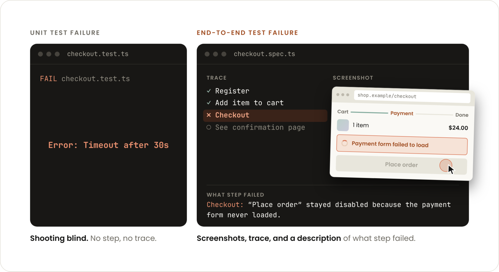

# Claude Code 团队如何看待验证

端到端测试、属性测试和差异测试，让编程智能体用证据验证自己的工作。Claude Code 团队还要保证：负责打分的那些检查，本身是诚实的。

> 原文：[How the Claude Code team thinks about verification](https://claude.dev/blog/how-the-claude-code-team-thinks-about-verification/)
>
> 作者：Addy Osmani
>
> 分类：工程
>
> 原文发布日期：2026 年 11 月 16 日
>
> 原文阅读时间：10 分钟
>
> 本文根据英文原文翻译。文中配图保存在站内，图中的对比另以表格列出。

在 Claude Code 团队，我们绝大多数代码（约 90%）由 Claude 编写，并由 Claude [审查](https://claude.dev/blog/solving-code-review-at-anthropic/)。到了这个规模，如何让智能体用证据验证自己的工作，就变得极其重要。

验证循环是你能把更多工作交给 Claude 的基础。没有它，你一次其实只能跑一两个 Claude，因为每件事都得自己检查。有了它，你可以并行跑几十个，甚至上百个。

这是因为，给智能体一种[验证输出的办法](https://claude.com/blog/building-verification-loops-in-claude-code-with-skills)，是提高质量的有效途径。在围绕结构化文件生成的内部测试中，让一个独立的评分器按评分标准检查 Claude 的工作，相比标准的提示循环，[任务成功率最多提高了 10 个百分点](https://claude.com/blog/claude-managed-agents)。最难的问题上，增益最大。

过去验证起来很贵的东西——测试、基准、规格说明、真正的端到端运行——现在交给智能体已经很便宜。和写代码一样，智能体可以很快生成测试、基准和规格说明。生成之后，这些测试和基准是作为软件运行的，因此可以频繁执行，而不必再消耗很多额外的 token。

你还可以把验证循环闭合起来，用结果改进智能体在这项任务上的表现。例如，如果智能体反复通不过一项“检查日志里有没有用户数据”的测试，就可以写一个钩子，或者在 `CLAUDE.md` 里加一条更明确的规则，避免以后再出同样的问题。这样，问题在大多数情况下就不会再次发生。

既然验证对高速产出高质量代码如此关键，你该用哪些类型的测试，又该如何把它们用到整条流水线上？这篇文章回答这些问题，并分享 Claude Code 团队实际使用的流程。

## 测试并不平等：值得投入的三种

无论你选哪种测试，都有几种失败模式要避开。

如果测试不稳定（flaky），你就是在训练智能体再跑一遍，而不是去修失败的代码。如果测试很慢，智能体在一批变更里能跑的测试就更少，定位问题也会更难。更重的测试，最好在提交变更之前跑。

下面是我认为最值得投入的三种测试。

### 端到端测试

如果只能重点做一种测试，就选端到端。这类测试描述真实的用户流程，比如把商品加入购物车、结账，然后进入确认页。

端到端测试之所以有效，是因为它们很难被蒙混过关：要么整个功能能用，要么不能用。它们还有明确的完成标准，并能具体告诉你哪里坏了。

单元测试可能只显示 “Error: Timeout after 30 seconds”，端到端测试则可以给出一张截图，并说明坏在哪里。

**图 A：单元测试失败与端到端测试失败**

| | 单元测试失败 | 端到端测试失败 |
| --- | --- | --- |
| 文件 | `checkout.test.ts` | `checkout.spec.ts` |
| 看到的结果 | `FAIL checkout.test.ts`，然后是 `Error: Timeout after 30s` | 步骤轨迹：注册通过，加入购物车通过，结账失败，确认页没有到达 |
| 失败现场 | 没有 | `shop.example/checkout` 的截图：1 件商品，$24.00，支付表单没有加载，Place order 按钮处于禁用状态 |
| 说明 | 盲目开枪。没有步骤，也没有轨迹。 | 失败步骤：结账时 “Place order” 一直禁用，因为支付表单从未加载。有截图，有轨迹，也有对失败步骤的说明。 |

单元测试更快，也不那么容易不稳定，但测试全过、功能仍然坏掉，是可能的。因为智能体和测试都不理解完整的任务。

有了端到端测试，给智能体一双看得见、也碰得到真实运行系统的手和眼睛，效果就会好很多。你可以用一个技能来启动、驱动并检查应用，工具可以是 [CDP](https://chromedevtools.github.io/devtools-protocol/)、模拟器，或 API 测试框架。

功能地图可以作为智能体的指南和评分标准。它通常从用户视角列出功能，并写明路径、键盘快捷键、选择器，以及预期结果。

### 属性测试：不能被打破的约束

很多测试基于你以为可能出错的地方。属性测试看的是人容易漏掉的边界情况，而智能体也常常在这里失败。

你先写下一个你认为不可能失败的陈述，再用测试库生成成千上万个输入，试图证明它其实会失败。JavaScript 和 TypeScript 可以用 [fast-check](https://fast-check.dev/)，Python 可以用 [Hypothesis](https://hypothesis.readthedocs.io/en/latest/)，Rust 可以用 [proptest](https://proptest-rs.github.io/proptest/)。

几乎每个软件项目里都有很多这类性质，例如：

- **往返编码**：先编码 X，再解码回来，得到的还是 X。解析和序列化同样适用。
- **不变量**：必须始终成立的事情，比如“账户余额永远不能变成负数”。
- **幂等**：把一个动作（迁移、规范化、重试）做两次，效果和做一次相同。
- **等价**：优化后的代码，与朴素但正确的代码，产生相同的结果。

属性测试库是让智能体保持诚实的好办法。它们用的边界情况，并不带有编写原始代码的那个智能体的同一种偏见。在重写时它们也特别有用：规格说明已经偏离了生产行为，不再是可靠的验证依据。

### 差异测试：旧系统就是预言机

差异测试对[大规模迁移](https://claude.com/resources/articles/ai-code-migration)特别有效，因为这类场景预期功能保持不变。旧系统在这里充当预言机：用相同输入分别跑旧系统和新系统，看结果是否不同。如果不同，就有缺陷或破坏性变更需要修复。

差异测试的关键，是使用随机生成的输入，或生产流量的一份样本。你还要把空白之类无关因素规范化，并维护一份已批准变更的清单，记下新环境本就应该和旧环境不同的地方。

## Claude Code 团队如何看待验证

我们之前写过 [Anthropic 的代码审查是如何运作的](https://claude.dev/blog/solving-code-review-at-anthropic/)（中文译文：[《Claude Code 团队如何进行代码审查》](<./Claude Code 团队如何进行代码审查.md>)）。这篇文章想更深入地谈谈，我们如何验证自己的工作。

### 验证就是把变更跑起来

把应用端到端跑一遍，比测试更重要。你不会不在模拟器里试过，就发布一项 iOS 改动。Claude 也一样。

Claude 可以像人，或者像 QA 工程师那样，测试整个应用。网页变更，让它使用 Claude 的 Chrome 扩展；移动端，使用 iOS 或 Android 的 MCP；桌面端，使用 computer use（计算机操作）；后端工作，则在本地把服务跑起来。

要把“如何启动模拟器或运行应用”固定下来，就创建一个名为 `verify` 的技能。把它放在仓库的 `.claude/skills/` 目录里，尽量靠近相关代码，需要多少就加多少。Claude 知道在提交变更之前使用 `verify` 技能。

然后投入精力，让 `verify` 技能又快又稳。让 Claude 反复迭代，并对它做压力测试。它是你的冒烟测试框架，所以要把它做得很稳。

当你给 Claude 一种端到端冒烟测试自己变更的办法，结果会好得多。你会看到它像人一样迭代，更快抓住真正的错误。Anthropic 几乎所有变更都是这样测试的。

### 失败的测试需要人来看

没有人能读完每一次变更，所以我们把失败当作决定“哪里需要人”的一种方式。Claude 运行检查，并尝试修复失败项。如果一项检查经过三轮仍然失败，Claude 就停下来，把人叫进来。

### 代码所有者自己写检查

拥有这段代码的人，自己为它编写检查，并不断打磨，直到检查标出的，就是所有者自己会标出的东西。当一项检查拉来审查者时，它应该说明原因，这样对方就不必从代码差异里自己推断。

### 可靠性检查由代码差异触发

我们维护一份包含 39 项的可靠性检查清单。每一项都有一个可以从代码差异中读出的触发条件、一项检查，以及它背后的事故或 PR。其中一项是 “`--resume` 会加载旧的会话记录”。当会话存储或消息类型发生变化时，我们会问：新字段能否安全加载？因为更早的会话记录里并没有它。

Claude 阅读代码差异，只检查触发条件匹配的那些项，通常是 3 到 10 项。这样，谁也不必把过去的故障记在脑子里。

### 一个审查者，多轮审查

我们并不靠叠更多审查者来提高审查质量。在主要审查者之上，再加一个更贵的第二审查者，往往不如把主要审查者调好。我们用一份 [REVIEW.md](https://code.claude.com/docs/en/code-review-customize) 写明：对这段代码，审查者应该关注什么。

我们还认为，审查轮次和验证轮次应该彼此衔接。每一轮都指向前几轮的上下文，以及过去的失败，而不是每次都从头检查一切。这样更省，也找得更多。

### 变更不能修改评判自己的检查

如果一次变更可以修改评判它的检查，这项检查就坏了。Code Review 从基线分支或默认分支读取 `REVIEW.md`，[从不读取拉取请求自己的改动](https://code.claude.com/docs/en/code-review-customize)。Claude Code 团队确保那些给变更设门禁的规则，位于这次变更改不到的分支上。

审查也只针对具体的提交。如果审查进行时还有人在推送，审查结果就不再有用。针对一个已经过时的提交给出的通过，说明不了任何问题。

团队还会先跑便宜的检查。如果智能体还没在本地测试就推送，它就花掉了共享的审查和 CI 时间，而这些错误它本来可以自己发现。在我们团队，Claude 会在发起拉取请求之前运行测试、构建和 lint。你可以用一个[钩子](https://code.claude.com/docs/en/hooks)，在 Claude 结束时运行测试；也可以把“测试套件通过”设成一个 [/goal](https://code.claude.com/docs/en/goal)。

### 新门禁先从观察模式开始

在我们自己的仓库里，每个提交都会标明它是如何被验证的。标记里甚至会写上 `none`，这样我们就能查出哪些提交没有经过验证。

我们还做了一个提交门禁：如果这次会话里没有出现 `/code-review` 或 `/verify`，就可以阻止这次提交。它有关闭、观察和强制三种模式。

观察模式会记录本来会被阻止的提交。这样我们可以复查误报，并确保没有人受到影响。

强制模式会阻止提交。任何提交都可以在说明里写上，为什么它没有经过验证。如果同一次会话里，提交已经被阻止了两次，下一次就会放行，以免 Claude 卡住。Claude Code 并不完美。

### 用真正要紧的事情检验你的检查

Claude Code 团队也会定期审查这些审查者。我们跟踪有多少已合并的变更被回滚，有多少变更在合并前被维护者拒绝，以及一组规模相当、此后一直保持干净的变更。

这也可以做成正式评测。在我们的[代码审查文章](https://claude.dev/blog/solving-code-review-at-anthropic/)里，我们描述了 Code Review 团队如何基于以往事故和回滚建立评测。对每个例子，他们把仓库恢复到审查当时的状态，并用一句话写出缺陷是什么，作为标准答案。只有正确描述了该缺陷的发现才得分。他们用已经合并且保持稳定的变更作为对照，防止过度标记。用来调优的集合，与用来评估系统的固定测试集，是分开的。

他们还分别评估了三个阶段的召回率：原始发现、验证之后、最终审查。这样就能看出，系统是不是把已经找到的缺陷弄丢了。把这些合成一个端到端分数的评测，捕捉不到这一层差别。

除了是否成立，我们关心的另一个维度是：做这项修改有多重要。好的审查者会抓住大多数技术上成立的问题，但人们真正关心的是，某个缺陷是必须修、应该修，还是只是一处细节。

Code Review 正是这个想法。它会把事项标成 [Important（重要）、Nit（细节）或 Pre-existing（已有问题）](https://code.claude.com/docs/en/code-review-pull-requests)。Pre-existing 表示，审查者不该让作者为一个本来就存在的缺陷负责。

最后，Claude Code 团队把召回率调高到这样一个地步：再往上提，就会是对评测过拟合，而不是真的抓住缺陷。

### 把漏掉的情况变成规则

在 Claude Code 仓库里，我们有两种办法把漏掉的情况变成规则。

第一种，是从人工代码审查评论和 PR 回滚中提取模式，找出常见问题。要成为一条潜在规则，它必须至少出现在两个 PR 里，并且能够从代码差异里看出来。三个智能体会试图证伪它，然后由人在 PR 里审查并批准。

第二种，是让三个缺陷查找器重放一个与已知事故相关的 PR。如果至少两个找到了这个缺陷，它就是可以发现的缺陷。如果缺陷出现在一份很小的代码差异上，却被漏掉了，这个缺口就值得写成 `REVIEW.md` 里的一条规则。

不稳定的测试也按同样方式处理。Claude 不能跳过它们，不能加 sleep，也不能一直重试直到通过。如果它找不到根因，就删掉这项测试，并写下原因。

规则也需要清理。测试套件、验证步骤和 `.md` 文件，只要放任不管，就只会越长越长。所以我们会按例行流程整理它们。

## 好测试，好结果

我们发现，给智能体一种带有强反馈循环的验证办法，会带来完全不同的结果。把验证层当成任何其他系统来对待：让它处在它所评判的变更够不着的地方；用对你真正重要的缺陷给它打分；漏掉东西时把教训写下来，使它不再发生第二次；再修剪这些教训，让它们仍然值得运行。

做到这些，你的工作就会从阅读每一份代码差异，转到定义“完成”是什么样，并审查证据。正是这一点，让你可以同时跑起许多个 Claude。
