# 智能体记忆的组成部分

索伦·克尔凯郭尔写道，生活只能向后理解，却必须向前去过。我们在为 AI 智能体设计记忆时，也碰到了同样的两难。

人类在生活中不断编码记忆。[海马体](https://stanford.edu/~jlmcc/papers/McCMcNaughtonOReilly95.pdf)在其中扮演核心角色：它在当下捕捉经历，让记忆迅速形成，并立即可用。但只有[一部分经历](https://www.science.org/doi/10.1126/science.adk8261)会被巩固为长期知识。

> 原文：[The components of agent memory](https://www.anthropic.com/research/components-of-agent-memory)
>
> 作者：Lance Martin
>
> 分类：工程
>
> 原文发布日期：2026 年 11 月 6 日
>
> 主题：智能体、上下文工程、智能体记忆
>
> 本文根据英文原文翻译。正文插图保存在站内，图中的主要数据另以表格列出。

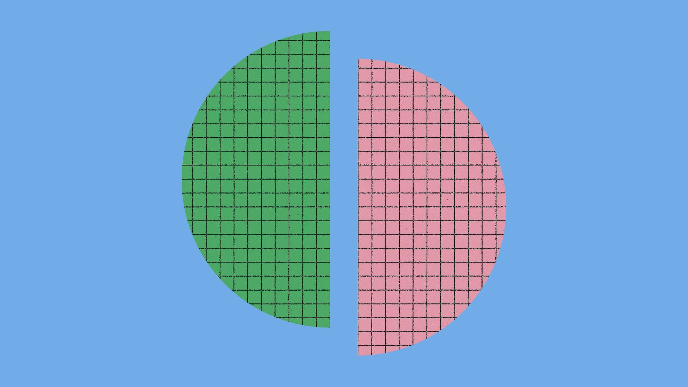

这种巩固大多发生在大脑离线的时候。我们睡觉时，以及在安静的[休息](https://www.nature.com/articles/s41467-018-06213-1)中，海马体会重放近期经历。人们认为，这会逐渐提炼[这些经历并把它们整合](https://www.nature.com/articles/s41593-019-0467-3)进新皮层——大脑中储存我们所谓“知识”的大部分区域。

智能体记忆可以采用类似的分工。智能体会把大量工作记在日志或会话记录里。Letta 和加州大学伯克利分校的研究者提出了[休眠期计算](https://arxiv.org/abs/2504.13171)（sleep-time compute）：让模型利用交互之间的空闲时间，重组已有上下文。同样的想法也能帮助智能体整理记忆：反思日志，修正错误，或产生新的笔记和表征。这一过程常被[称作](https://platform.claude.com/docs/en/managed-agents/dreams)[做梦](https://research.google/blog/the-sleep-framework-a-new-way-for-llms-to-retain-knowledge-in-continual-learning/)（dreaming）（图 1）。

我们发现，做梦是帮助我们赋予 Claude 有效记忆的有用工具。本文分享我们对智能体记忆的看法，并走过几项用于探索智能体记忆的评估，包括做梦的用法，以及每个组成部分对记忆组织的贡献。

**图 1：Claude 可以用做梦来组织记忆**

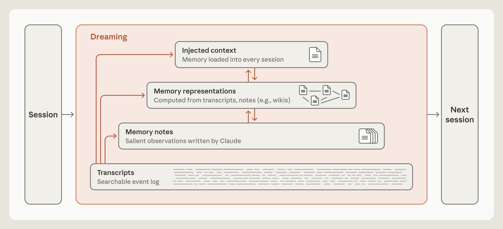

做梦可以修正错误、创建笔记、建立新的记忆表征，或决定未来会话会预先加载什么。记忆层级自下而上是：

| 层级 | 内容 |
| --- | --- |
| 会话记录 | 可搜索的事件日志 |
| 记忆笔记 | Claude 写下的笔记 |
| 记忆表征 | 例如维基 |
| 注入的上下文 | 加载进每一个会话 |

在标为“做梦”的框里，箭头从会话记录指向上方每一层；相邻的上层之间则双向连通。

## 记忆笔记

所谓“智能体记忆”，是指 Claude 从经验中获得、并在会话之间保留下来的知识。这些经验包括与用户的交互，以及分配给它的任务。记忆保存为以后可以阅读的上下文。它不包括模型学习或管理上下文的其他方式，例如对权重的修改（训练时设定的内部参数）、[上下文学习](https://www.anthropic.com/research/in-context-learning-and-induction-heads)（in-context learning，单次对话中获得的知识），以及[压缩](https://platform.claude.com/docs/en/build-with-claude/compaction)（compaction，Claude 写下摘要，替换较早的回合，以便在新的上下文窗口里继续工作）。

在人脑中，经历之前、期间或之后释放的化学信号，可以把一段记忆[标记为重要](https://www.nature.com/articles/385533a0)。被标记的记忆在离线时段往往比未标记的记忆更频繁地被重放。这一过程称为重放（replay），有助于把它们稳定下来，并整合进长期记忆。

类似地，Claude 可以在会话日志中实时标记显著事件，方便以后查找；也可以把它们[写](https://platform.claude.com/docs/en/agents-and-tools/tool-use/memory-tool)进记忆存储，例如一个记忆笔记文件夹（图 2）。但在还不知道接下来会发生什么的时候，Claude 如何判断此刻什么是显著的？

**图 2：Claude 可以把笔记写入记忆**

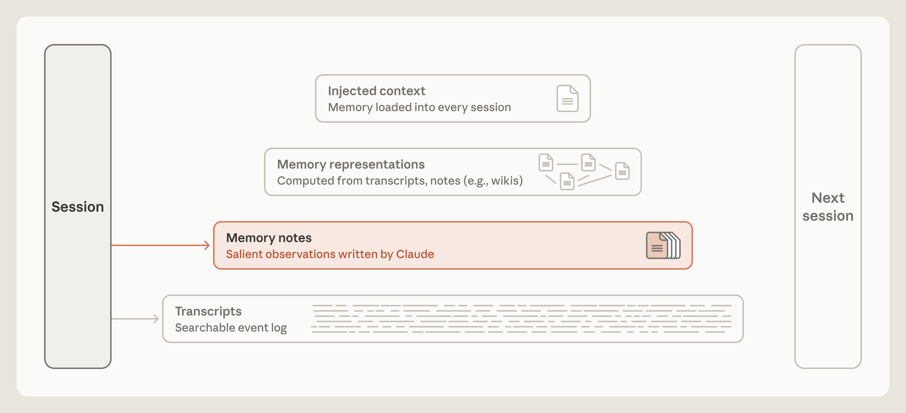

同一记忆层级里，记忆笔记一层被标出。箭头从当前会话直接指向记忆笔记，表示 Claude 写下的显著观察。

## 记忆有时是对未来需要什么的预测

记忆偶尔是一种预测。写下一条规则时，智能体是在预测：它所描述的模式还会再次相关。例如，写下一条已核实的事实，就是在预测未来某个会话里的智能体会想直接依赖这条事实，而不再核对一遍。随着时间推移，Claude 在做这类预测上已经好得多。

来看[持续学习基准 CL-Bench 1.0](https://continual-learning-bench.com/news/cl-bench-1-0/)（Continual Learning Bench）中的一项任务。该基准衡量智能体运用记忆来完成长程任务的能力。其中一项任务要求 Claude 查阅数据库，回答一系列问题。Claude 给出答案后，会被告知正确答案，并可以写下一则记忆，帮助回答以后的问题。

记忆可以在这里支撑一个学习循环。如果 Claude 答错了，它可以记下这次失败，提出出错原因的假说，检验这些假说，再把发现变成以后如何作答的规则。

我们用 [Claude 托管智能体](https://platform.claude.com/docs/en/managed-agents/overview)（Claude Managed Agents）运行了 CL-Bench 1.0 的这项任务。Claude 每一题都从全新会话开始，只有一个例外：它可以从一个跨会话保留的[记忆目录](https://platform.claude.com/docs/en/managed-agents/memory)中取回文件。

不同模型在建立自己的学习循环上，成功程度不同。Claude Sonnet 4.6 最多走到为“答案为什么错”生成假说。它的记忆目录里散落着一些文件，每份列出几条未经检验的猜测。

**图 3：CL-Bench 数据库任务，比较有记忆与无状态基线**

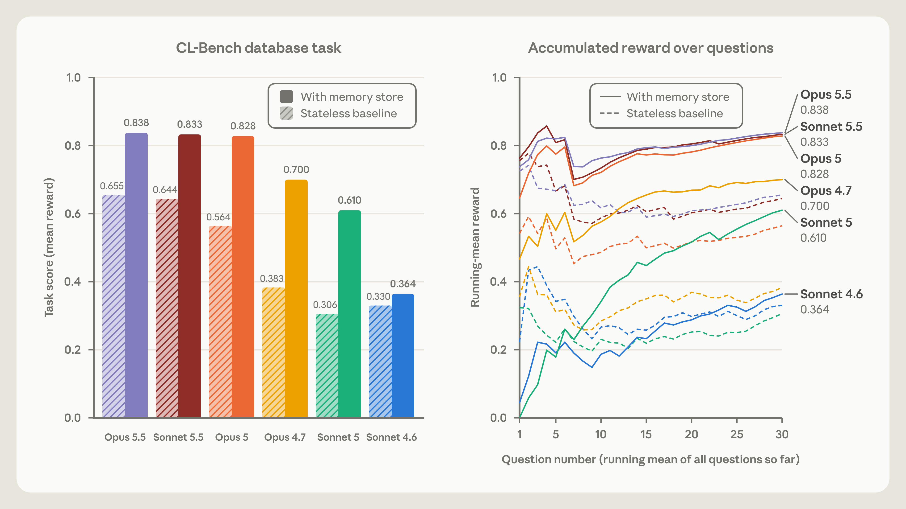

左图是平均奖励：

| 模型 | 无记忆基线 | 有记忆 |
| --- | --- | --- |
| Opus 5.5 | 0.655 | 0.838 |
| Sonnet 5.5 | 0.644 | 0.833 |
| Opus 5 | 0.564 | 0.828 |
| Opus 4.7 | 0.383 | 0.700 |
| Sonnet 5 | 0.306 | 0.610 |
| Sonnet 4.6 | 0.330 | 0.364 |

右图是同样这些模型在 30 道题上的滑动平均奖励，分别画出有记忆和无记忆两条线。原文没有给出逐题数值。

Claude Opus 4.7 把笔记合并成一份参考文档，并开始标记哪些事实已经核对、哪些仍未确认。Claude Sonnet 5 会在评分器检查之后把每个答案标为已确认；答错时则写下一则更正。

Claude Opus 5 是这些模型里第一个形成闭环的。它的大多数条目都包含一条规则（以及它如何知道这条规则为真）、先前问题的答案，以及对沿途发现的陷阱的明确警告（图 3）。

和 Opus 5 一样，Claude Opus 5.5 与 Claude Sonnet 5.5 也都形成了闭环，用记忆捕捉已经验证的规则，说明以后怎样作答最好。有了记忆，两者的得分都与 Opus 5 大致相当，尽管它们在没有记忆时的基线略高一些。

## Claude 已经学会判断显著性

我们还评估了 Claude 玩《宝可梦 红》的能力。这款游戏[要求 Claude 完成复杂的长程导航](https://www.youtube.com/watch?v=CXhYDOvgpuU)，用来检验它对“什么值得存进记忆”的判断。每次运行开始时，我们给每个模型一个记忆文件夹，游戏过程中它可以读，也可以写（图 4）。

我们比较了 Claude Sonnet 3.7 和 Claude Fable 5 各一次运行的记忆文件夹，此时两者都大约进行到第 10,000 步。一个关键差别是，每个模型认为什么值得记住。Sonnet 3.7 假定一切都可能重要，不加区分地写入记忆。它的记忆文件夹像一份遭遇档案，常常为每一场战斗、每一件物品、每一个非玩家角色单独建文件。最终，Sonnet 3.7 在 225 个文件夹里写了 413 个记忆文件，只获得一枚徽章。徽章标志着玩家在游戏中的进度。

相比之下，Fable 5 在两个文件夹里写了九个文件，外加一个顶层文件 `global.md`，并获得了四枚徽章。

**图 4：玩宝可梦时，Sonnet 3.7 与 Fable 5 的记忆目录**

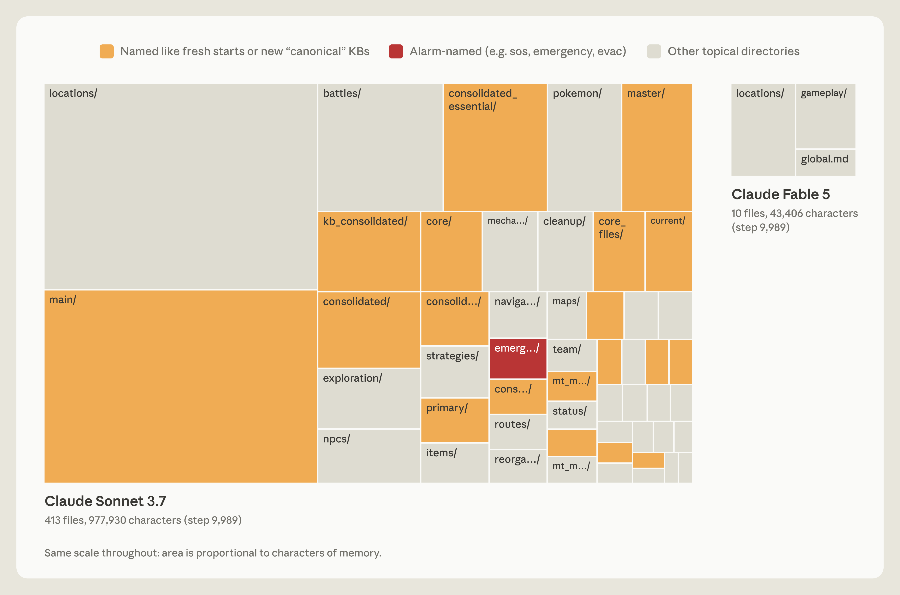

面积表示记忆字符数，两次运行使用同一比例。

| 模型 | 文件数 | 字符数 | 主要位置 | 徽章 |
| --- | --- | --- | --- | --- |
| Sonnet 3.7 | 413 | 977,930 | locations、main、battles，以及若干 consolidated 文件夹 | 1 |
| Fable 5 | 10 | 43,406 | locations、gameplay，以及 `global.md` | 4 |

Sonnet 3.7 的做法之所以成问题，主要是因为宝可梦的游戏状态一直在变，它那份详细记录也一直在过时。结果是，随着推进，Claude 不得不花更多时间和资源翻找记忆，而不是玩游戏。例如在大约第 10,000 步，Sonnet 3.7 开始写第四个 “master” 记忆文件夹。接下来的 17 步里，它创建了六个文件，删除了另外九个，游戏本身没有任何动作。

Fable 5 则把记忆用在游戏没有明确告诉它的事情上。Sonnet 3.7 写入记忆的某些信息——比如玩家有多少钱，或玩家在地图上的位置——每一回合都能从屏幕上读到，存下来是多余的。相反，关于策略、计划和已检验规则的记忆，只有 Claude 自己推演出来才会存在；除非写下来，否则就会消失。

Fable 5 据此组织记忆。`global.md` 充当仪表盘，放着当前目标、攻克道馆的预先计划（道馆是赢得徽章的挑战），以及模型自己使用记忆的规则。`locations` 文件夹存放特定路线的导航计划，`gameplay` 文件夹存放它根据游戏机制学到的策略。例如，连续七个精灵球都没能抓住一只鲤鱼王（最容易抓的宝可梦之一）之后，Claude 写道：“如果连续 3 个以上精灵球失败，就改变投掷时机（在菜单步骤之间多按几次 wait）——这样做之后立刻抓到了。”（If 3+ balls fail in a row, VARY the timing (insert extra ‘wait’ presses between menu steps) - the catch landed right after doing this.）

记忆文件夹小得多的 Fable 5，在游戏里比 Sonnet 3.7 走得远得多。Opus 5.5 采取了类似做法：它保持一个很小的记忆笔记文件夹，跟踪当前目标和下一步，边玩边改写，并且通关了。

## 引导 Claude 写记忆

我们发现，告诉 Claude 记忆是用来做什么的，会有帮助；但不要告诉它该怎么用。在 CL-Bench 上，我们只告诉 Claude 有一个记忆文件夹可用。这种一般性指引就足以让 Opus 4.7 和 Opus 5 有效使用记忆，并给两者带来明显提升（图 3）。

我们还测试了关于“应该把什么写入记忆”的具体规则，每次测试一条。我们比较的是：有这条规则时，模型从记忆中获得的增益，相对于没有这条规则时变化了多少。当规则设为“只记录失败”时，Opus 5 和 Opus 4.7 都失去了记忆带来的大部分提升（图 5 右）。对更强的模型来说，让它们自行判断显著性，比事先定下固定规则更有效；那些规则最终还可能削弱表现。

**图 5**

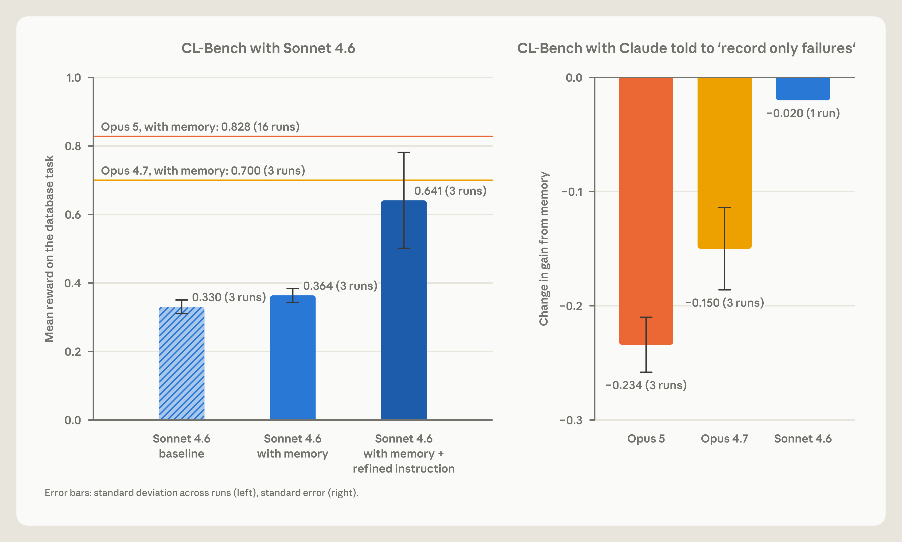

左：Sonnet 4.6 在 CL-Bench 数据库任务上的平均奖励，比较有没有用来引导记忆使用的提示。

| 条件 | 平均奖励 |
| --- | --- |
| 基线 | 0.330 |
| 有记忆 | 0.364 |
| 有记忆，并加上改进后的指令 | 0.641 |

参照线：Opus 4.7 有记忆时为 0.700，Opus 5 有记忆时为 0.828。

右：被告知“只记录失败”之后，各模型从记忆中获得的增益变化了多少。

| 模型 | 增益变化 |
| --- | --- |
| Opus 5 | -0.234 |
| Opus 4.7 | -0.150 |
| Sonnet 4.6 | -0.020 |

我们也注意到，引导对较旧的模型帮助最大。例如，Sonnet 4.6 经常不读记忆目录里的文件，也没有检验自己关于答错原因的假说。

在这种情况下，提示 Claude 在作答前阅读记忆文件，然后再明确检验自己的假说，几乎把它的基准分数提高了一倍（图 5 左）。Sonnet 5 会自己这样做。没有额外提示时，它 10 次里有 9 次会在作答前阅读记忆。相比之下，Sonnet 4.6 这样做的次数不到一半。

对于前沿的 Claude 模型，我们通常只给简单指引：当有人要求，或者某件事明显值得记住时，就创建记忆笔记，并把这一判断留给 Claude。

## 做梦可以修正记忆

Claude 根据自己在会话内判断为显著的内容来写记忆。因此，一条从一开始就错、或随着环境变化而漂移的笔记，可能在以后的会话里被读到，并被信任。

做梦给了 Claude 一种办法：拿笔记去对照原始会话记录（图 6）。Claude 用托管智能体玩宝可梦、并把记忆目录挂载上去时，我们看到了一个正面例子。

**图 6：做梦可以修正记忆中的错误**

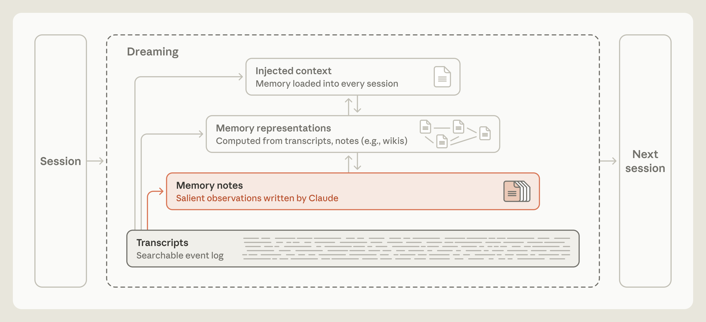

在带有做梦的记忆层级里，箭头从会话记录层指向上面的记忆笔记层，表示做梦对照会话记录修正笔记。

游戏中有一段，玩家必须穿过月见山。这是一个洞穴系统，入口在地图西侧，出口在东侧。入口附近有一个陷阱：一道单向岩架会把玩家掉回来时的路线，而且没有明显的办法爬回去。Claude 把山入口处的宝可梦中心当作地标，所以它会不会走下岩架，取决于它认为宝可梦中心在山的哪一侧。

有一次，Claude 错误地记下：宝可梦中心在东侧。走出宝可梦中心时，它宣布 “Mt Moon is behind me”（月见山在我身后），并把笔记更新为 “Mt Moon DONE”（月见山已完成）。但月见山并不在它身后。几个动作之后，Claude 走过岩架，落回它来时的路线（图 7）。导航工具没有显示这段下落，于是 Claude 认定 “I overshot far west”（我往西走过头了），并且自己一直在正确的一侧。其实不是。

**图 7：一条被修正的记忆笔记改变了宝可梦里的结果**

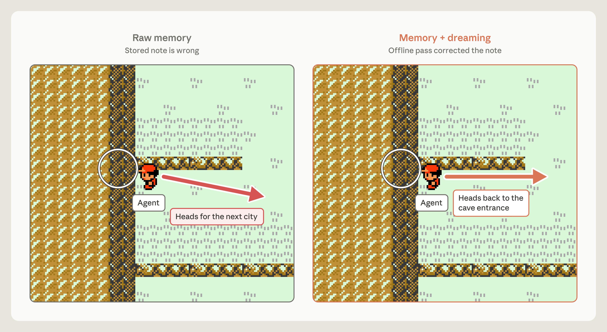

两幅地图里，智能体都在岩架旁边。

- 未修正的记忆（Raw memory）：存下的笔记是错的。Claude 说 “Mt Moon is behind me”，朝下一座城市走，结果回到来时的路线。
- 记忆加做梦：一次离线处理修正了笔记。Claude 说 “Now I need to find the Mt Moon cave entrance to re-enter”（现在我得找到月见山洞穴的入口，再进去），然后回到洞里。

我们随后测试，做梦能否帮助 Claude 避开这个陷阱。我们对那个记错宝可梦中心位置的记忆文件夹运行做梦：Claude 拿笔记对照会话记录，发现了错误，并改写了它。会话记录提供了可以用来核验证记忆的事实依据。有了修正后的笔记，Claude 直接回到月见山，并最终到达华蓝市。

在笔记未修正的那次运行里，Claude 三次掉回来时的路线。第三次失败后，它似乎放弃了，写道：“I’m going to stop rather than keep looping.”（我打算停下来，而不是继续循环。）我们的设置会自动回复，让它继续。于是它继续走，一路回到山前的深灰市，希望在那里治疗并补给。这次运行结束时，Claude 始终没有到达华蓝市。

**图 8：做梦修正记忆之后，Claude 回到洞穴并到达下一座城市**

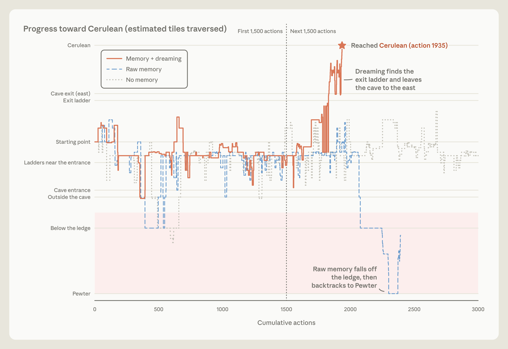

图中是累计 3,000 个动作内、朝华蓝市推进的折线。

- 记忆加做梦：在第 1,935 个动作到达华蓝市。
- 未修正的记忆（Raw memory）：掉下岩架，折返深灰市，始终没有越过这座山。
- 没有记忆：也始终没有到达华蓝市。

## 做梦可以建立新的记忆表征

借助做梦，Claude 可以建立帮助它在记忆中导航的表征（图 9）。它使用的一种记忆表征叫做[维基](https://gist.github.com/karpathy/442a6bf555914893e9891c11519de94f)（wiki）：由 Claude 撰写并维护的一组页面，汇集它对某一主题的了解，并链接到其他笔记。这些链接实际上给了 Claude 一张地图，用来筛选记忆，并在需要时把相关记忆找出来。

**图 9：做梦可以建立记忆表征**

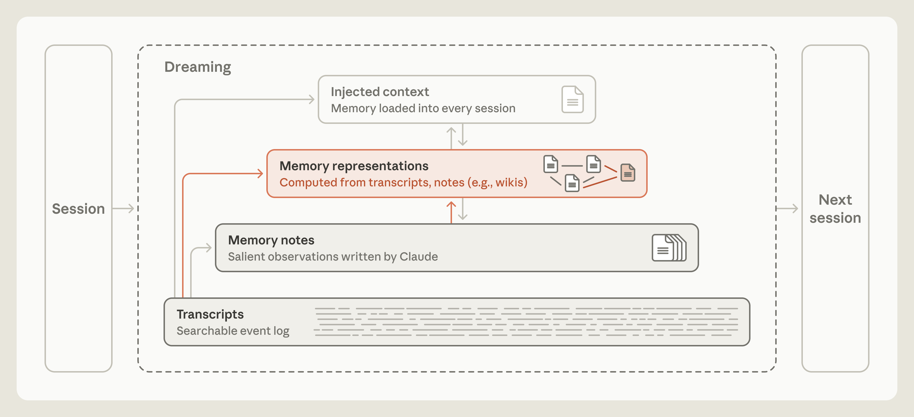

在带有做梦的记忆层级里，箭头从会话记录和记忆笔记指向记忆表征层，例如维基。

像维基这样的表征，可以帮助 Claude 遍历不断增长的知识库。我们用一批内部文档来考察这种好处。文档来自 Stainless，一家我们在 5 月收购的软件公司，大约 35 万个文件、约 4.2 亿 token。我们为这批文档做了 25 道题的评估集，并给 Claude 一个搜索工具来探索它们。我们还让 Claude 用做梦基于这些文件建立维基。在 128 个会话里，我们提示 Opus 5 智能体探索文件、撰写或修正相互链接的维基页面、合并重复项，并对照来源核对说法。

每个会话都建立在先前会话的进展之上，并用一份共享日志协调工作。做梦从 2 个会话扩展到 128 个时，这 25 道题上达到的评分标准比例从 13% 增长到 48%（图 10）。

Claude 是增量建立维基的。创建初始维基之后，后续几轮做梦用来增补、编辑或修剪。早期轮次里，Claude 的知识像一名新员工，只靠维基回答问题的能力有限。它梦得越多，知识地图就越丰富，像一名资深员工。测试中，维基在同时提供搜索工具时帮助最大。搜索和维基一起用时，随着维基增长，合计分数从 54% 升到 61%；只有搜索工具时是 53%。只靠维基回答时，最好成绩是 48%。同时使用搜索和维基，每道题还大约节省 20,000 个 token。

**图 10：随着连续会话中维基的建立，25 道关于一家公司文档的问题得分如何变化**

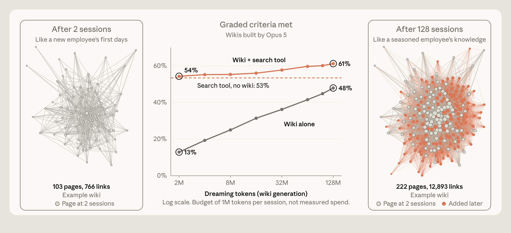

中图是做梦 token 从约 200 万增长到 1.28 亿时，达到的评分标准比例：

| 条件 | 变化 |
| --- | --- |
| 维基 + 搜索工具 | 从 54% 升到 61% |
| 仅维基 | 从 13% 升到 48% |
| 只有搜索工具、没有维基 | 持平在 53% |

左右两图是同一份示例维基。每个点是一页，线连接有链接的页面。

| 阶段 | 页面数 | 链接数 |
| --- | --- | --- |
| 2 个会话之后 | 103 | 766 |
| 128 个会话之后 | 222 | 12,893 |

我们想知道，哪些任务会从维基中受益。为此使用了 [Harvey LAB](https://github.com/harveyai/harvey-labs) 基准，以及一批关于一次并购的文档。基准给 Claude 一组文档，要求它根据内容生成法律备忘录，再按一份标准清单打分。这些评估也许不如一局宝可梦吸引人，但文档集合足够多样，可以用来建立维基。

我们让 Claude 根据文档建立维基，然后让它分别从维基和从直接文件搜索来回答并购问题，或生成 LAB 基准中的法律备忘录。一项测试提出 24 个关于这次并购的问题（图 11 左）。其中超过一半需要跨多份文档查找信息，许多还需要判断或计算。在这些题目上（图中的红线与橙线），查阅维基时得分 87%，只用搜索时是 73%。

**图 11：每幅图左侧是被评分的内容，右侧是满足每一条所需的源文档**

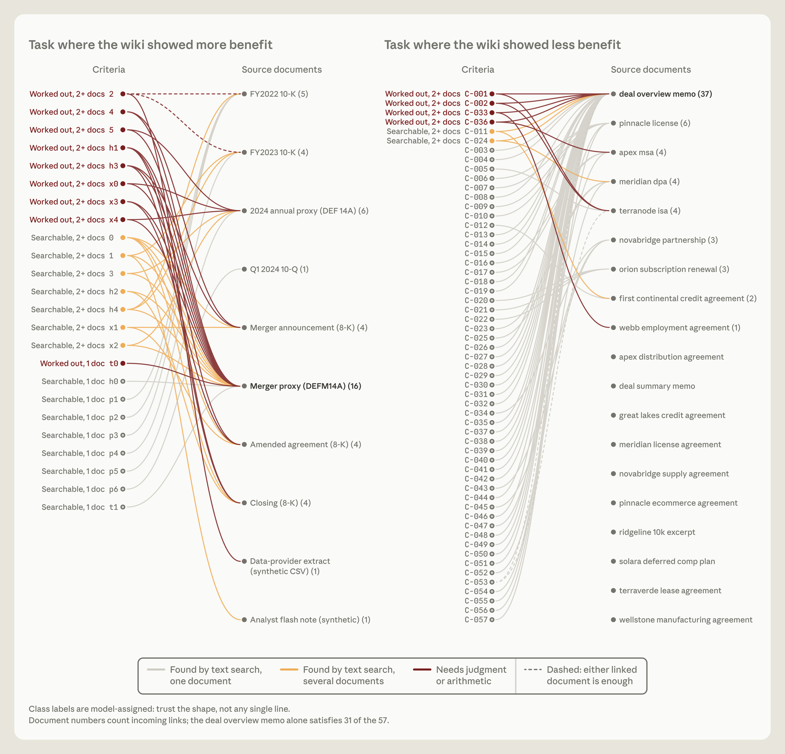

- 左：24 个关于一次并购的问题，大多可以靠公开文件回答。超过一半的标准需要综合多份文档。24 条标准里，大多数连接到 10 份文档中的两份或更多；其中 9 条需要判断或算术。维基在这里收益更明显。
- 右：一项维基没有显示出明确收益的 LAB 任务。57 条标准里，大多数可以用文本搜索从单份文档中找到，通常是交易概览备忘录。

在另一些情况下，维基用处较小。在一项 LAB 任务上（图 11 右），备忘录标准常常可以用文本搜索从单份文档取回，维基相对于搜索没有明确的性能收益。在另一项 LAB 任务上，维基长得比文档本身还大（图 12）。就像博尔赫斯那篇只有一段的短篇《论科学的精确性》里的制图师：他们绘制的地图详细到与所代表的帝国一样大。Claude 做了一份极其详细的维基，实际上什么也没有抽象出来。

**图 12：维基长得比原始文件还大**

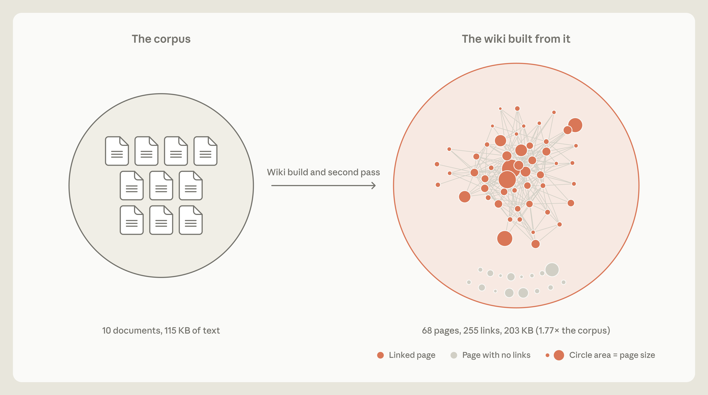

图中展示维基的建立以及再处理一次。左侧圆圈是语料，箭头指向由此建成的、更大的维基。维基里有些页面没有任何链接。

| | 规模 |
| --- | --- |
| 语料 | 10 份文档，115 KB 文本 |
| 维基 | 68 页，255 条链接，203 KB，约为语料的 1.77 倍 |

## 做梦可以把笔记提升到记忆层级的顶部

做梦还可以把笔记浮到记忆层级的顶端。智能体运行框架可以在每个会话开始时，预先把它们加载进 Claude 的上下文（图 13）。这样 Claude 不必去搜索，甚至不必知道有东西可搜。

把记忆提升进新会话，是一种上下文注入，必须谨慎。注入的记忆会占用宝贵的 token，一条错误笔记还可能被带进每一个会话。加载一条笔记也不保证 Claude 会照做：我们在 [Claude Code](https://code.claude.com/docs/en/memory) 的文档里提醒过，更长的指令文件会降低遵从度。因此顶层必须保持相对小。做梦在这里的很多工作，就是维持这种小：把一些细节下移，并留下链接。

[Claude Code 的自动记忆](https://code.claude.com/docs/en/memory)用同样的方式保持注入层很小，由 Claude 在会话期间维护。它不会把全部自动记忆加载进每个会话的上下文窗口，只加载 `MEMORY.md` 的前 200 行或 25 KB。这段开头是一份索引，告诉 Claude 自己知道什么、到哪里去找。

**图 13：做梦可以写到记忆层级的顶部**

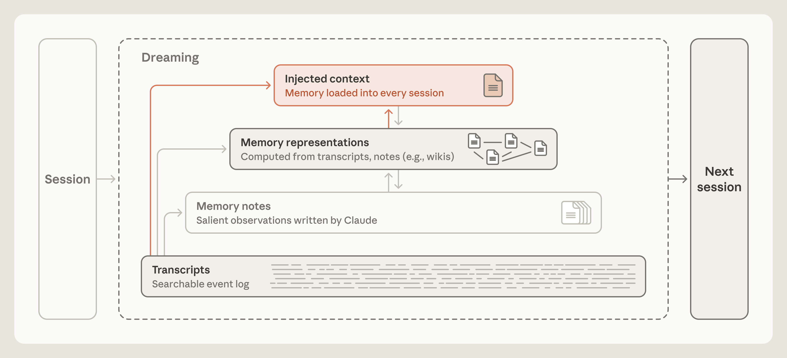

箭头从会话记录和记忆表征指向最上方的注入上下文，这一层会送入下一个会话。注入的上下文加载进每一个会话；下面各层则在 Claude 需要时被阅读或搜索。

## 做梦可以让记忆聚焦于特定目标

做梦还可以塑造记忆如何生长。例如 [Claude Duet](https://support.claude.com/en/articles/17631495-get-started-with-claude-duet) 这样的助手，往往受益于围绕它所帮助的那个人来组织记忆。做梦可以被调节，好让记忆服务于某个特定目标。

指导记忆如何生长的指令因任务而异，它们告诉 Claude 哪些信息真正重要。LAB 基准中有一项任务模拟公司收购，并提供一组合同。备忘录是否得分，取决于它有没有正确描述合同条款。

我们一开始用的是生成维基的基本指令，并没有告诉 Claude 该如何使用这份维基。这项任务严重依赖合同条款。维基构建期间，几个智能体同时往一张共享的合同条款表里写（图 14 左）。

**图 14：指令改变前后，有多少被评分的合同事实进入了维基**

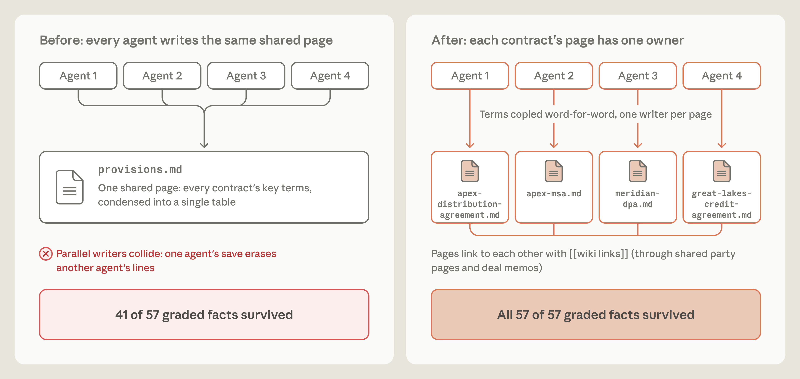

- 左：几个智能体写进同一共享页面；57 条事实里留下了 41 条。图中是四个智能体写进同一个 `provisions.md`，一次保存会抹掉另一个智能体写下的行。
- 右：每份合同由一个智能体写自己的页面，并逐字引用条款；57 条事实全部留下。

结果是一份缺少关键事实的维基。根据这份维基生成的备忘录里，Claude 只包含了 57 条事实中的 41 条（72%）。查看原因时发现，共享表格把合同条款概括得很差，有些条款干脆缺失，因为智能体互相覆盖了彼此的工作。

合同条款是维基里最重要的部分，但指令没有这么说。为了找到更好的指令，我们跑了一个循环：Claude 反思失败，提出对指令的修改，然后重建维基。这个循环让它发现，紧跟合同条款有多重要，并据此改写了建立维基的指令。

每份合同有自己的一页，由单个智能体撰写，条款逐字引用，而不是概括进一张共享表。根据这份改进后的维基生成备忘录时，100% 的标准都可以满足，之前是 72%。

## 做梦可以补上单个会话留下的缺口

Claude 写记忆笔记时，只能看到那一个会话里的上下文。做梦可以跨许多会话搜索，找出共同模式，或修正共同的错误。

为 LAB 基准建立维基时（例子见图 14），Claude 有时会链接到尚未创建的页面。第二轮做梦补上了许多这样的缺口。在一项任务上（图 15），做梦发现了九条指向缺失页面的链接，并把它们改指向同一份文档已经存在的页面。它还新增了三个页面，包括一份索引，用来改进维基。

**图 15：第二轮做梦前后的维基**

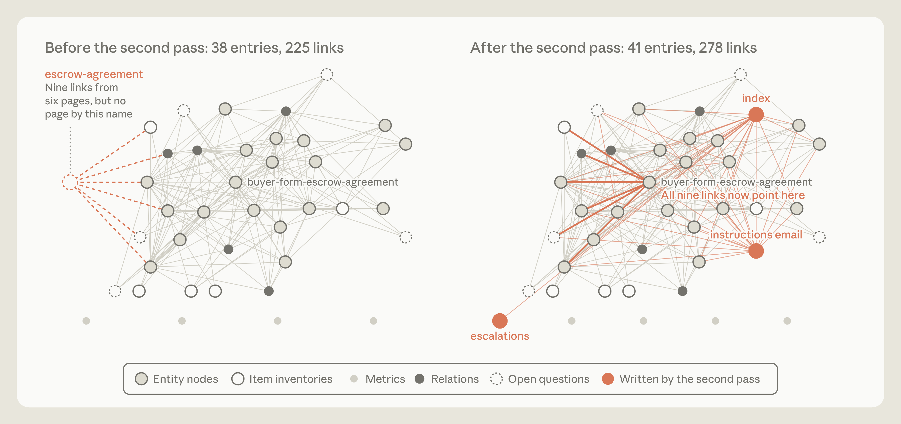

| | 条目 | 链接 | 发生了什么 |
| --- | --- | --- | --- |
| 第二轮之前 | 38 | 225 | 来自 6 个页面的 9 条链接指向并不存在的 `escrow-agreement` |
| 第二轮之后 | 41 | 278 | 这 9 条链接全部指向 `buyer-form-escrow-agreement`；新增 index、instructions email 和 escalations 三页 |

## 向后思考，向前看

为智能体设计记忆系统，还有许多开放问题。其一是 Claude 应当何时创建记忆。它做任务时，可以写入记忆存储，例如文件夹、文件或数据库，在源头捕捉显著性，让重要细节立刻可供以后的回合或会话使用。但当下记笔记，不可避免地会把注意力从主任务上拉开。做梦可以把记忆创建推到后台，可它的产出未必能立刻被 Claude 用上。

另一个问题是如何让记忆可靠地保持最新。Claude 可能做出错误预测，或把从一开始就错的规则写进记忆。环境一变，记忆也可能漂移，变得不再相关。做梦是修正这些错误的一种方式（图 8），但它需要计算。让 Claude 持续检查全部记忆，也许并不现实。更要紧的，可能是把做梦集中在很可能变化的信息上，或仔细调节做梦的节奏，例如按记忆被访问的频率来安排。

把会话记录搜索当作 Claude 记忆的基础，也说得通。把表征（例如维基）和搜索结合起来（图 10），有时会有效。但 Claude 仍要用计算来维护这些表征，并确保它们不积累错误或幻觉。

尽管 Claude 对显著性的判断已经变好，没有任何模型真能知道未来回合会发生什么。做梦给了它一个向后看的机会：用计算组织记忆、修正错误，并维护让未来会话更容易取用记忆的表征。随着 Claude 能力增强，记忆系统还会演化。如何设计它的记忆系统，我们仍有很多要学。

动手可以从这两份教程开始：[开始使用做梦](https://platform.claude.com/cookbook/managed-agents-cma-dreaming-with-a-dynamic-workflow)，以及[知识维基](https://github.com/anthropics/claude-quickstarts/tree/main/managed-agents/knowledge-wiki)。

## 致谢

本文由 Lance Martin 撰写，Caitlin Love、Tom Chivers、Rebecca Hiscott、Jake Eaton 和 Blake Wilson 提供编辑指导。感谢 Barry Zhang、Theodora Chu、Daliang Li、Mahesh Murag、Jake Noble、Ravi Trivedi、Tina Vachovsky、Brad Abrams、Henry de Valence、Jeremy Fox、Matt Bell、Allen Li、Chris Gorgolewski、Eugene Yan、Artur Renault、Wei Zhang 和 Kevin Chen 的讨论与贡献，并感谢 David Hershey 的 Claude Plays Pokémon。插图由 Monika Tuchowska 绘制。
